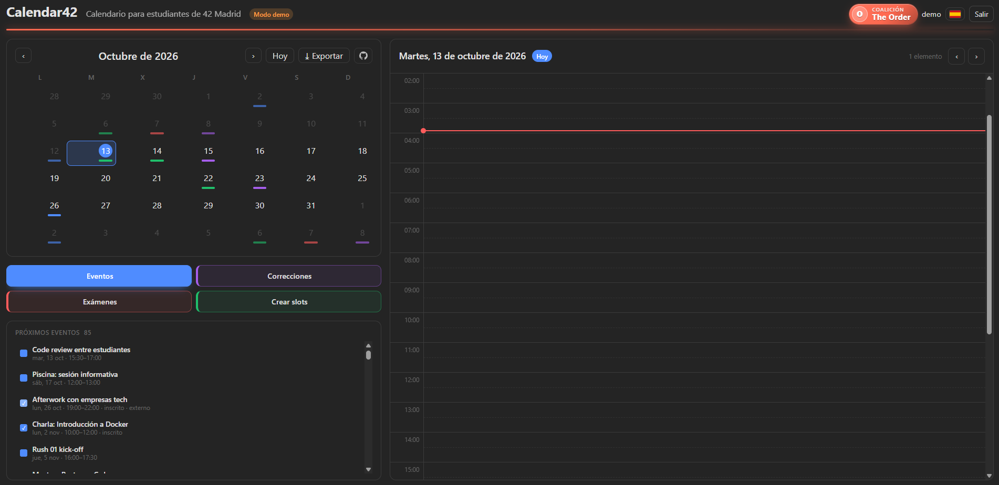
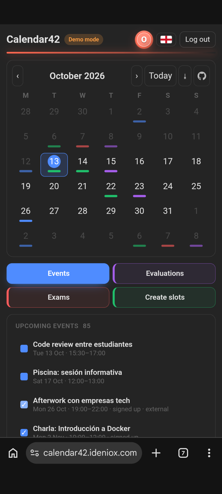

# Calendar42

**Una sola agenda para todo lo que tienes en 42: eventos, exámenes, slots y correcciones.**

<p align="center">
  <a href="https://calendar42.ideniox.com"><strong>calendar42.ideniox.com</strong></a>
  &nbsp;·&nbsp; con modo demo interactivo, sin necesidad de cuenta de 42
</p>

<p align="center">
  <a href="https://calendar42.ideniox.com">
    
  </a>
</p>
<p align="center">
  <sub>El mes, los modos y los próximos eventos a la izquierda; las horas del día elegido a la derecha.</sub>
</p>

## El problema

En la intra, cada cosa vive en su sitio: los eventos en un apartado, los exámenes en otro, los slots de corrección en otro y las correcciones agendadas en otro más. Ninguna de esas vistas sabe nada de las demás.

Donde más duele es al agendar correcciones. Mientras eliges hora no ves qué horas tienes ya ocupadas, ni siquiera las correcciones que ya has agendado. Si reservas tres seguidas, las tienes que llevar de memoria para no pisarte.

## Qué hace



Calendar42 une esas cuatro vías en una agenda: eventos, exámenes, slots y correcciones, juntos en el mismo mes y en las mismas horas del día. Y desde esa agenda puedes actuar sobre ellos sin pisar lo que ya tienes.

- **Vista del mes y del día**, con una marca de color por tipo y cada elemento en sus horas. Al pulsarlo se abre su ficha completa, con la descripción en Markdown como en la intra.
- **Eventos**: todos los eventos futuros del campus, con los tuyos marcados. Te apuntas y te borras desde la ficha. Los externos van en un azul más claro y enlazan a su web de inscripción.
- **Correcciones**: eliges un proyecto cerrado, ves en el calendario los slots libres de otros estudiantes junto a tu propia agenda y reservas la corrección.
- **Exámenes**: los disponibles del próximo mes. La API de 42 no deja a los estudiantes inscribirse, así que el botón lo explica; en el modo demo sí funciona.
- **Crear slots**: arrastrando con el ratón o tocando una hora con el dedo, ajustando con tiradores o en pasos de 15 minutos. Se respetan los 15 minutos libres que la intra exige entre slots.
- **Sin solapes**: ninguna acción que añade algo a tu agenda (apuntarte, reservar, crear un slot) se permite si choca con lo que ya tienes. El botón sale desactivado con el motivo, y los errores de la intra se muestran junto a él.
- **Exportar** tu agenda a `.ics` para importarla en Google Calendar, Outlook o Apple Calendar; al reimportarla se actualiza sin duplicar.
- **Móvil**: dos vistas, el mes con los modos y el día a pantalla completa.
- **Cualquier campus**: la agenda es la del campus de quien entra, y le saluda por su nombre. Español o inglés, con un selector de bandera en la cabecera; por defecto, español en los campus de España e inglés en el resto.

<br clear="right">

## Origen

Calendar42 nació en una hackathon de 42 Madrid, donde quedó en segundo puesto. Sergio Valero (`svalero`) colaboró en la idea inicial y en el pitch. Desde entonces el proyecto sigue en este repositorio, mantenido por Jorge Martínez (`jomarti3`).

## Integración con la API de 42

Calendar42 utiliza la API de 42 como fuente de información para construir la agenda del usuario.

| Recurso | Para qué | Token |
|---|---|---|
| `GET /v2/me` | Usuario y campus principal tras el login | usuario |
| `GET /v2/users/:id/coalitions` | Coaliciones a las que ha pertenecido el usuario (piscina, discovery, cursus...) | usuario |
| `GET /v2/blocs` | Coaliciones del cursus actual en el campus, para mostrar esa y no la de la piscina | usuario |
| `GET /v2/campus/:id/events` | Eventos del campus | usuario |
| `GET /v2/users/:id/events` | Eventos en los que el usuario está inscrito | usuario |
| `GET /v2/users/:id/events_users` | Inscripción del usuario a un evento (su id hace falta para borrarse) | usuario |
| `POST /v2/events_users` | Apuntarse a un evento | usuario |
| `DELETE /v2/events_users/:id` | Borrarse de un evento | usuario |
| `GET /v2/events/:id` | Releer un evento tras apuntarse o borrarse (número de inscritos) | usuario |
| `GET /v2/campus/:id/exams` | Exámenes del campus | app |
| `GET /v2/users/:id/exams` | Exámenes en los que el usuario está inscrito | app |
| `GET /v2/me/slots` | Slots de corrección del usuario | usuario |
| `GET /v2/me/scale_teams` | Correcciones planificadas | usuario |
| `GET /v2/projects/:id` | Nombre del proyecto de una corrección | usuario |
| `GET /v2/users/:id/projects_users` | Proyectos del usuario y su estado (cerrado, en curso, finalizado); los exámenes se descartan por su slug | usuario |
| `POST /v2/slots` | Abrir un slot de corrección propio (la intra lo trocea en bloques de 15 min) | usuario |
| `DELETE /v2/slots/:id` | Borrar un bloque de slot propio | usuario |
| `GET /v2/projects/:id/slots` | Slots libres de otros estudiantes para corregir un proyecto | usuario |
| `GET /v2/projects/:id/scales` | Escala de evaluación del proyecto, necesaria para reservar | usuario |
| `POST /v2/scale_teams` | Reservar una corrección (puede estar reservado al personal) | usuario |
| `POST /oauth/revoke` | Revocar los tokens de una sesión al salir, al entrar de nuevo o al caducar | app |

## Puesta en marcha

Necesitas Node 22.18 o superior (ejecuta el TypeScript del servidor directamente, sin compilar) y una aplicación OAuth registrada en:

https://profile.intra.42.fr/oauth/applications

La aplicación debe utilizar como redirect URI:

`http://localhost:5173/api/auth/callback`

y los scopes:

`public`, `projects` y `profile` (este último hace falta para apuntarse y borrarse de eventos).

```bash
nvm install 22
nvm use 22
npm install
cp .env.example .env
```

Rellena `FT_CLIENT_ID` y `FT_CLIENT_SECRET` en `.env` con el UID y SECRET de la aplicación OAuth.

Después:

```bash
npm run dev
```

La aplicación estará disponible en:

- Web: `http://localhost:5173`
- API: `http://localhost:3112`

Todo el código es TypeScript en modo estricto. Para comprobarlo:

```bash
npm run typecheck   # tipos del frontend y del servidor
npm run lint
```

`npm run build` comprueba los tipos antes de compilar el frontend.

El **modo demo con datos de ejemplo** está siempre disponible en la pantalla de login, también con credenciales: así se puede enseñar la aplicación aunque la intra esté caída o rechace las peticiones. Cada entrada al demo empieza limpia: lo que el visitante cambia (inscripciones, slots, reservas) va en su propia sesión, así que varios visitantes pueden probarlo a la vez sin pisarse.

## Docker

Para ejecutarlo como un solo servicio, con la API sirviendo también el frontend compilado, están `docker/Dockerfile` y `docker/docker-compose.yml`, y en la raíz un `Makefile` con el ciclo de vida:

```bash
make build     # construye la imagen
make start     # levanta el servicio en http://localhost:3000 (construye si hay cambios)
make logs      # sigue los logs
make stop      # para y elimina el contenedor
```

También `make restart`, `make status`, `make shell`, `make clean` (borra además la imagen y el volumen de sesiones) y `make doctor`, que muestra el puerto y la URL que se van a aplicar y quién ocupa ese puerto en el host: es lo primero que mirar si `make start` falla con "port is already allocated". Sin `make`, desde la raíz del repositorio: `docker compose --project-directory . -f docker/docker-compose.yml` seguido de `build`, `up -d --build`, `logs -f` o `down`.

El contenedor lee las credenciales del mismo `.env`. Como todo va por el puerto 3000, el login de la intra vuelve a `http://localhost:3000/api/auth/callback`: registra también esa redirect URI en la app OAuth. Para publicarlo con otra URL, define `PUBLIC_URL` (y `PUBLIC_PORT` para el puerto del host) en `.env`. Las sesiones se guardan en el volumen `calendar42-data` y sobreviven a reinicios.

## Estructura

```text
server/   Express: OAuth, sesiones y la API propia; en producción sirve
          también dist/. intra.ts habla con la API de 42. Node lo ejecuta
          tal cual; tsc solo comprueba los tipos (server/tsconfig.json)

shared/   Tipos del contrato de la API, compartidos por servidor y frontend

docker/   Dockerfile y docker-compose.yml: imagen y servicio. El ciclo de
          vida va en el Makefile de la raíz (make start | stop | logs | build)

src/      React: Calendar, ModeBar (los cuatro modos), ProjectPicker, ItemList,
          SlotCreator, DayView (con arrastre para crear slots), ItemPopover,
          LoginView; carga de datos y acciones sobre la intra en App.tsx.
          api/ llama a la API propia; subscription.ts tiene las reglas de
          cada botón (qué se puede hacer y, si no, por qué); i18n/ tiene
          los textos en español (es.ts) e inglés (en.ts)
```
